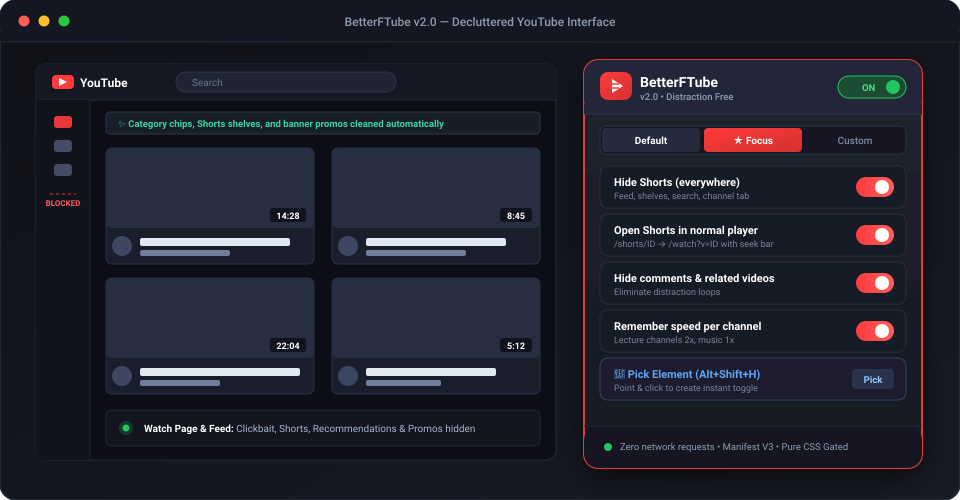
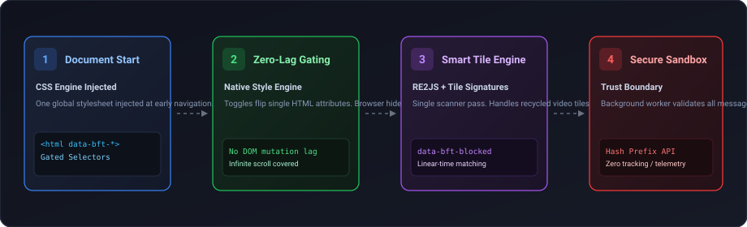

<div align="center">


# BetterFTube

**Declutter YouTube with toggles • Fast, focused, and distraction-free**

*A privacy-first, zero-telemetry extension crafted for Chromium and Firefox — powered by WXT and React 19.*

<p>
  
  
  
  
  
  
</p>

---

<p>
  <a href="#-about-betterftube">About</a> •
  <a href="#-key-features">Features</a> •
  <a href="#-visual-tour">Visual Tour</a> •
  <a href="#-toggles--controls-reference">Toggles Reference</a> •
  <a href="#-installation--setup">Installation</a> •
  <a href="#-keyboard-shortcuts">Shortcuts</a> •
  <a href="#-architecture--under-the-hood">Architecture</a> •
  <a href="#-privacy--security-model">Privacy</a> •
  <a href="#-development--testing">Development</a> •
  <a href="#-icon--design-philosophy">Design</a> •
  <a href="#-limits--specifications">Limits</a>
</p>



</div>

---

## 📺 About BetterFTube

Modern YouTube is engineered around algorithmic hooks: endless Shorts carousels, algorithmic mixes, clickbait recommendation feeds, autoplay spirals, and notification red-dots designed to retain your attention.

**BetterFTube** restores your agency. It is a lightweight, high-performance browser extension that lets you selectively toggle away every distracting surface of YouTube while preserving the video player and core creator content.

- 🛡️ **Zero Network Requests by Default**: Runs 100% locally. The extension does not phone home, does not load remote configurations, and collects zero telemetry or analytics.
- ⚡ **CSS-First Performance**: Rules are injected directly at `document_start` with `<html data-bft-*>` attribute gating. Toggles trigger native browser style recalculations without JavaScript DOM mutation lag.
- 🎯 **Surgical Control**: Choose exactly what to hide—from Shorts shelves and comment sections to donation badges and view-count thresholds.
- 🌐 **Privacy-First Online Enhancements**: The two optional online features (SponsorBlock skipping and Return YouTube Dislike counts) are strictly opt-in and use anonymized hash-prefix lookups.

---

## ✨ Key Features

<table>
  <tr>
    <td width="50%">
      <h3>🧹 Feed &amp; Shorts Decluttering</h3>
      <p>Remove Shorts shelves from feeds, search, and channel tabs. Automatically redirect <code>/shorts/</code> links to the standard desktop player with scrub bars and speed controls.</p>
    </td>
    <td width="50%">
      <h3>⏱️ Smart Video Filtering &amp; Blocklists</h3>
      <p>Filter out videos shorter or longer than <em>N</em> minutes, below <em>N</em> views, or older than <em>N</em> days. Block channels or keywords with linear-time ReDoS-safe regex matching.</p>
    </td>
  </tr>
  <tr>
    <td width="50%">
      <h3>🎬 Distraction-Free Watch Experience</h3>
      <p>Toggle off comments, right-panel recommendation rabbit holes, end-screen overlays, info cards, live chat, merch shelves, and hashtag walls above video titles.</p>
    </td>
    <td width="50%">
      <h3>🎛️ Intelligent Player Defaults</h3>
      <p>Default to Theater Mode, automatically disable autoplay-next, enforce standard playback quality, and <strong>remember custom playback speeds per channel</strong>.</p>
    </td>
  </tr>
  <tr>
    <td width="50%">
      <h3>🎯 Interactive Element Picker</h3>
      <p>Point and click on any element on YouTube (<code>Alt+Shift+H</code>). Choose selector specificity with live DOM match counts, and turn it into a custom toggle instantly.</p>
    </td>
    <td width="50%">
      <h3>⚡ Opt-in SponsorBlock &amp; Dislike Counts</h3>
      <p>Seamlessly skip sponsor segments and restore dislike numbers. Fetches are routed through the background worker with per-origin permission prompts and hash prefixes.</p>
    </td>
  </tr>
</table>

---

## 📸 Visual Tour

### 1. Minimalist Feed &amp; Subscriptions
Eliminate algorithm traps and category pills. Route directly from Home to Subscriptions to see only creators you explicitly follow.

<p align="center">
  
</p>

### 2. Interactive Element Picker (`Alt+Shift+H`)
Found something annoying that isn't covered by a built-in toggle? Open the Element Picker directly from the popup or shortcut. Hover over the element, inspect live matches, and convert it into a toggleable rule.

```
[ Element Picker ] ──> Point & Click Target ──> Preview Match Count (e.g. 1 match) ──> Save as Toggle
```

### 3. Quick Profile Cycling (`Alt+Shift+P`)
Switch instant presets depending on your current mode:
- **Default**: Balanced decluttering with clean navigation.
- **Focus**: Pure video immersion — hides comments, recommendations, sidebar clutter, and chat.
- **Custom**: Your own combination of toggles, CSS rules, and selector blocks.

---

## 🎚️ Toggles &amp; Controls Reference

| Category | Available Toggles &amp; Actions |
|---|---|
| **Feed** | Hide Shorts (shelves, search, sidebar, channel tab) • Open Shorts in normal player • Redirect Home → Subscriptions • Hide category chips • Keyword/channel blocklist • Hide watched (≥90%) • Hide Mixes • Hide Live streams • Hide Upcoming • Hide Community posts • Hide Playables • Hide Promos &amp; Banners |
| **Filters** | Hide shorter than *N* min • Hide longer than *N* min • Hide fewer than *N* views • Hide older than *N* days • **Allowlist mode** (only show channels you list) |
| **Watch Page** | Hide Comments • Hide Related videos • Limit right-panel suggestions count • Hide End-screen cards • Hide Info cards &amp; watermark • Hide Merch/products/donations • Hide Hashtags above title • Hide Live chat • Align title &amp; channel • Quick copy `youtu.be` link on Share button • Hide Share button (with `Ctrl+C` fallback) |
| **Player** | Disable autoplay-next • Theater mode by default • Default playback quality • Hide "Premium-only" 1080p qualities • Default speed • **Remember speed per channel** (e.g., 2× for lectures, 1× for music) |
| **Navigation** | Hide Explore section • Hide "More from YouTube" • Hide Sidebar footer links • Hide Notifications bell • Hide Create button • Hide Voice search |
| **Custom** | User-defined CSS editor • Custom element-picker rules (each converted to a toggle) • Live selector diagnostics with element counts |
| **Online (Opt-in)** | **SponsorBlock** auto-skip (configurable category skips) • **Return YouTube Dislike** ratio &amp; counts |

---

## 🚀 Installation &amp; Setup

BetterFTube is built using modern Manifest V3 standards and runs on all major modern browsers.

### Chromium Browsers (Google Chrome, Brave, Edge, Ungoogled Chromium)

1. Clone or download the repository:
   ```bash
   git clone https://github.com/projectGloria/BetterFTube.git
   cd BetterFTube
   ```
2. Install dependencies and compile the extension:
   ```bash
   npm install
   npm run build
   ```
3. Open `chrome://extensions` in your browser.
4. Enable **Developer mode** (toggle in the top-right corner).
5. Click **Load unpacked** and select the `.output/chrome-mv3` directory.

> [!TIP]
> After updating the code or pulling new changes, simply run `npm run build` again and click the refresh icon on the BetterFTube card in `chrome://extensions`.

---

### Firefox (128+, Developer Edition, or Nightly)

1. Build the Firefox-targeted MV3 bundle:
   ```bash
   npm run build:firefox      # Compiles to .output/firefox-mv3
   npm run zip:firefox        # Packages .output/betterftube-2.0.0-firefox.zip
   ```
2. **Temporary Load:**
   - Navigate to `about:debugging#/runtime/this-firefox`.
   - Click **Load Temporary Add-on...** and select `.output/firefox-mv3/manifest.json`.
3. **Permanent Load (Firefox Developer Edition / Nightly):**
   - Go to `about:config` and set `xpinstall.signatures.required = false`.
   - Navigate to `about:addons` → Gear icon ⚙️ → **Install Add-on From File...** and pick the `.zip` file.

---

## ⌨️ Keyboard Shortcuts

| Shortcut | Action | Description |
|---|---|---|
| <kbd>Alt</kbd> + <kbd>Shift</kbd> + <kbd>Y</kbd> | **Master Toggle** | Turn all BetterFTube toggles on/off instantly without reloading. |
| <kbd>Alt</kbd> + <kbd>Shift</kbd> + <kbd>P</kbd> | **Cycle Presets** | Step through Default, Focus, and your saved Custom presets. |
| <kbd>Alt</kbd> + <kbd>Shift</kbd> + <kbd>H</kbd> | **Element Picker** | Launch the on-screen picker to target and hide any YouTube element. |
| <kbd>Ctrl</kbd> + <kbd>C</kbd> | **Quick Copy Link** | When hovering or focusing the Share button, copies a clean `youtu.be` link. |

*Shortcuts can be customized anytime via `chrome://extensions/shortcuts` or `about:addons`.*

---

## 🛠️ Architecture &amp; Under the Hood

<p align="center">
  
</p>

### Codebase Organization

```
lib/
├── features.js          # Single source of truth: toggle IDs, labels, selectors, types & permissions
├── settings.js          # storage.local engine & normalize() trust boundary
├── presets.js           # Built-in presets (Default, Focus) & cycling logic
├── blocklist.js         # Pure matcher for keywords, regexes, handles, and channel names
├── filters.js           # Parsers & predicates for duration, view counts, upload dates, allowlists
├── behaviors.js         # Isolated-world JS: redirects, theater mode, tile scanner, speed memory
├── picker.js            # Shadow-DOM element picker UI & selector candidate generator
├── speeds.js            # Isolated per-channel playback speed persistent store
├── online.js            # SponsorBlock skipping & dislike overlay handlers
├── api.js               # Background-only fetchers for SponsorBlock & Return YouTube Dislike
└── dom.js               # World-agnostic DOM helpers, attribute readers, and SPA lifecycle hooks
entrypoints/
├── youtube.content.js      # Isolated world: early CSS injection & settings → <html> attributes
├── youtube-main.content.js # MAIN world: quality & speed controls via YouTube's Player API
├── background.js           # Service worker: context menus, hotkeys, and API permission routing
├── popup/                  # React 19 popup interface
└── options/                # React 19 settings, blocklists, presets & backup manager
ui/                         # Shared React hooks, diagnostic bars, and permission handlers
tests/                      # Unit tests (Node runner) and Playwright E2E suites
```

### Engineering Highlights

1. **Native CSS Attribute Gating**:
   A single stylesheet is injected at `document_start`. Every rule is gated by an `<html data-bft-{id}>` attribute. Flipping a switch in the popup alters one attribute on `<html>`, allowing the browser's hardware-accelerated style engine to apply rules immediately with zero layout thrashing.
2. **One Rule Per Selector**:
   In CSS, a single invalid or unparseable selector invalidates an entire rule block. BetterFTube generates individual rules for each selector so that YouTube A/B tests or selector variations never compromise an entire toggle.
3. **Resilient Tile Signature Scanner**:
   YouTube recycles DOM elements during infinite scrolling. BetterFTube generates content signatures for video tiles (rather than storing raw DOM node references), applying `data-bft-blocked` and `data-bft-filtered` markers accurately.
4. **ReDoS-Proof Blocklist Matching**:
   Channel and keyword filters run through `RE2JS`, guaranteeing linear-time regex matching and eliminating Regular Expression Denial of Service (ReDoS) risks.
5. **Local Mirroring for Instant Start**:
   Selected attribute states are mirrored into YouTube's local storage to prevent layout flicker on initial navigation before extension storage initializes.

---

## 🔒 Privacy &amp; Security Model

> [!IMPORTANT]
> **BetterFTube makes zero network calls by default.** It operates entirely within the boundaries of your local browser session.

- **Explicit Origin Permissions**:
  Third-party network permissions (`sponsor.ajay.app` and `returnyoutubedislikeapi.com`) are declared as `optional_host_permissions`. They are never requested at install time. If you choose to enable an online feature, your browser displays a permission prompt for that single origin only.
- **Hash-Prefix SponsorBlock Lookups**:
  To protect your viewing history, BetterFTube uses SponsorBlock's 4-character SHA-256 hash prefix API. The complete video ID is never transmitted.
- **Background Worker Validation**:
  All network operations and storage modifications pass through strict background worker sanitization, validating video ID formats, length caps, and permission states before dispatching requests.
- **Isolated Storage Boundaries**:
  User rules, CSS, and channel speeds are strictly bounded (500 custom rules, 2,000 blocklist entries, 100,000 CSS characters) to prevent browser memory exhaustion.

---

## 💻 Development &amp; Testing

### Prerequisites
- Node.js 20+ (Node 22 or 24 recommended)
- npm 10+

### Development Commands

```bash
# Start Chromium with live extension reloading
npm run dev

# Start Firefox with MV3 live reloading
npm run dev:firefox

# Run pure logic and DOM regression tests
npm test

# Run Playwright E2E browser tests (Chromium)
npm run build
npm run test:e2e
```

### Adding a New Toggle

Adding a feature takes just one entry in [lib/features.js](file:///c:/Users/Nihil/Desktop/Gloria%20Repoz/BetterFTube/lib/features.js):

```javascript
{
  id: 'hide-example-element',
  group: 'feed',
  label: 'Hide Example Element',
  hint: 'Removes the example element from feeds',
  default: true,
  hide: [
    'ytd-rich-section-renderer:has(#example-id)',
    'ytd-guide-entry-renderer[aria-label="Example"]'
  ]
}
```

*For behaviors that require player interaction or custom scripting, omit `hide` and attach a listener in [lib/behaviors.js](file:///c:/Users/Nihil/Desktop/Gloria%20Repoz/BetterFTube/lib/behaviors.js).*

---

## 🎨 Icon &amp; Design Philosophy

<div align="center">


</div>

> *"A vibrant crimson screen holding a clean play glyph, segmented by horizontal louvers representing precision filtering, clarity, and user sovereignty."*

The visual identity of BetterFTube reflects its mission:
- **The Crimson Screen**: A familiar nod to YouTube's canvas, reclaimed and focused.
- **The Filter Louvers**: Symbolizes the fine-grained control louvers that filter out algorithmic noise.
- **High-Contrast Clarity**: Engineered for legibility across browser toolbars, dark mode interfaces, and system extension trays from 16px to 128px.

---

## ⚙️ Limits &amp; Specifications

To maintain maximum browser performance and prevent storage bloat, BetterFTube enforces deterministic limits:

- **Blocklist &amp; Allowlist**: Up to 2,000 entries per list; maximum 512 characters per entry.
- **Regex Patterns**: Up to 50 active regex rules using RE2JS; 4,096 total pattern characters; evaluates the first 2,000 characters of video titles.
- **Custom Rules &amp; CSS**: Up to 500 selector rules; 2,048 characters per selector; 100,000 characters for custom stylesheets.
- **Backup Files**: Settings imports are sanitized and capped at 2 MB.

---

## 📜 License &amp; Credits

- **License**: Distributed under the [MIT License](LICENSE).
- **Online Services**: Sponsor segment skipping powered by [SponsorBlock](https://sponsor.ajay.app). Dislike ratings powered by [Return YouTube Dislike](https://returnyoutubedislikeapi.com).
- **Disclaimer**: BetterFTube is an independent open-source project and is not affiliated with, endorsed by, or associated with YouTube&trade; or Google LLC.
